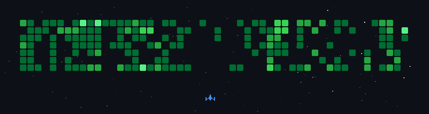

# 💫 About Me:

Hey there! 👋 I'm Sumanth, an engineering student passionate about software development, data analytics, and artificial intelligence. 💻 I enjoy building real-world applications, exploring new technologies, and turning innovative ideas into practical solutions. 🚀 I'm continuously improving my skills in programming, web development, databases, and AI while working on projects that help me grow as a developer. 🌱 My goal is to become a skilled software engineer and contribute to innovative products at leading technology companies. Outside of coding, I'm a football enthusiast ⚽ and an anime lover 🎌.

## 🌐 Socials:
  

# 💻 Tech Stack:
        

### ✍️ Random Ahh Dev Quote

 

  

<!-- Proudly created with GPRM ( https://gprm.itsvg.in ) -->
