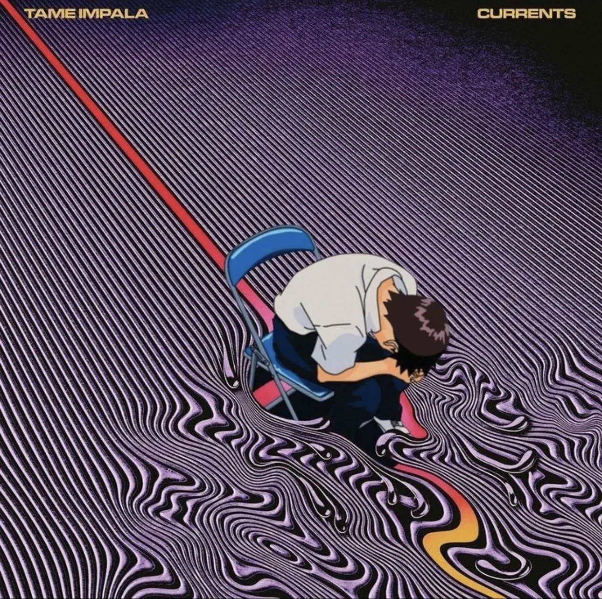

## 💫 About Me
<table>
<tr>
<td width="60%" valign="middle">
Hey there! 👋 I'm Sumanth, an engineering student passionate about software development, data analytics, and artificial intelligence. 💻

I enjoy building real-world applications, exploring new technologies, and turning innovative ideas into practical solutions. 🚀

I'm continuously improving my skills in programming, web development, databases, and AI. 🌱

My goal is to become a skilled software engineer and contribute to innovative products at leading technology companies.

Outside of coding, I'm a football enthusiast ⚽ and an Manhwa & Manhua Reader 🎌.
</td>
<td width="40%" align="center" valign="middle">

</td>
</tr>
</table>

<h2>🌐 Socials</h2>

<table width="100%">
  <tr>
    <td width="40%" align="center" valign="middle">
      
    </td>
    <td width="60%" align="center" valign="middle">
      

        
      

      

        
      

      

        
      

    </td>
  </tr>
</table>

<h2 align="center"> Knowledge IG📖</h2>
<table width="100%">
  <tr>
    <td width="50%" align="center" valign="middle">
      

        
        
      

      

        
        
      

      

        
        
      

      

        
        
      

      
Always learning, always building. 🚀

    </td>
    <td width="100%" align="center" valign="middle">
      
    </td>
  </tr>
</table>

### ✍️ Random Dev Quote

 

  

<!-- Proudly created with GPRM ( https://gprm.itsvg.in ) -->
